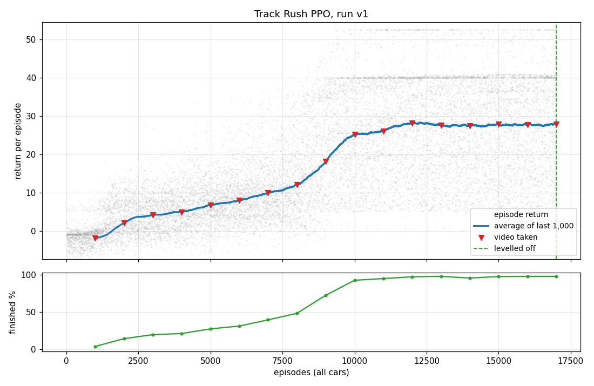

# Track Rush PPO

A Trackmania-style racing game in Unity, and PPO written from scratch in PyTorch that teaches its
cars to drive. With 100 cars learning at once, the policy goes from random wandering to finishing
98% of its runs in about 6 minutes of training.

https://github.com/user-attachments/assets/f4a8af85-b31b-4688-a32c-fb5ce436f045



The full training report, with a video of the best run every 1000 episodes, is in
[Training/reports/v1/REPORT.md](Training/reports/v1/REPORT.md).

## What's here

| Path | What |
|---|---|
| `Assets/Scripts/TrackRush/` | The game: tracks built in code, car physics, time attack with medals and ghosts |
| `Assets/Scripts/TrackRush/ML/` | The RL side of the game: `RacerAgent` (44 observations, 2 actions, rewards) and `TrainingManager` |
| `Training/` | Python: the env wrapper, actor-critic, GAE, the PPO update, parallel envs, video recording and reports |
| `Packages/com.unity.ai.inference/` | Unity's inference package, embedded to fix a duplicate Protobuf DLL in player builds |

The agent sees its own motion, its pose relative to the road and the road 10 to 140 m ahead; it
controls steering and pedal. It earns reward for progress, checkpoints and finishing, and loses some
for grass, walls, and crashing, getting stuck or driving the wrong way.

## Running it

Unity 6000.6 (6.6) with URP. Open the project once and build both players from the **Track Rush** menu:
**Build Training Environment (Linux)** (headless, for training) and **Build Game (Linux)** (the game).

```bash
cd Training
python3.10 -m venv .venv && source .venv/bin/activate   # mlagents-envs 1.1.0 needs Python 3.10
pip install mlagents-envs==1.1.0 torch tensorboard matplotlib
python smoke_test.py                                   # check the connection
python ppo.py --run-id v1 --instances 2 --cars-per-track 10 --video-every 1000 --until-stable
python play.py runs/v1/checkpoint.pt --game 100        # watch the result in the game
python export_onnx.py runs/v1/checkpoint.pt --install --build   # race it: AI RIVAL in the menu
```

[Training/README.md](Training/README.md) describes every script and option, and
[Training/steps.md](Training/steps.md) is a step-by-step guide to the RL itself.

Car and track models: [Kenney Racing Kit](https://kenney.nl/assets/racing-kit) (CC0).
