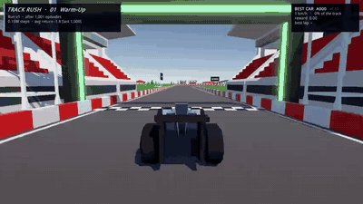
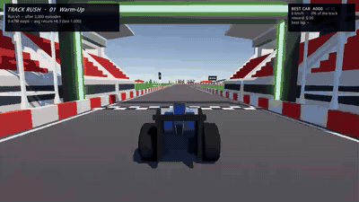
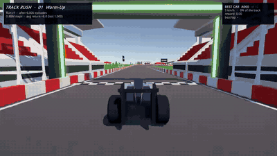
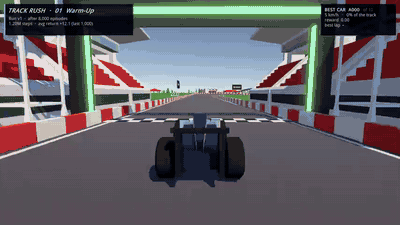
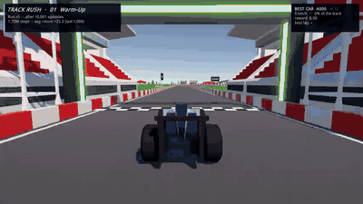
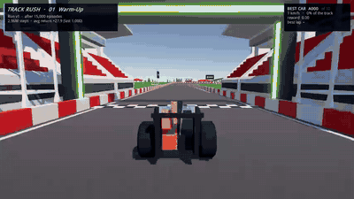

# Track Rush PPO: run `v1`

PPO written from scratch (PyTorch) driving the cars of a Trackmania-style Unity game. Started 2026-10-17 10:05; ran 3.43M decisions over 17,000 episodes in 6 min, and stopped because the reward curve levelled off.

| | |
|---|---|
| Final average return (last 1,000 episodes) | **+27.97** |
| Best block average | +28.22 (at 12,000 episodes) |
| Best single episode | +52.55 |
| Finish rate, last block | 98% |
| Best lap in the videos | 0:30.080 |
| First filmed finish | after 9,000 episodes |
| Cars training at once | 100 (2 game instance(s)) |

## The best run at each milestone

Every 1,000 episodes the current policy was saved and filmed: 10 cars from a mass start (car A000 drives the deterministic policy, the others sample from it as in training), with the camera on whichever car is furthest ahead. Filming stops when the first car crosses the line, which with a mass start is the fastest lap. Click a GIF for the full video.

### 1,001 episodes  ·  0.15M steps

Training average -1.8, finish rate 4%. Filmed best run: best return +1.3, no car finished within 45 s.

### 3,000 episodes  ·  0.47M steps

Training average +4.3, finish rate 20%. Filmed best run: best return +12.2, no car finished within 33 s.

### 6,000 episodes  ·  0.88M steps

Training average +8.0, finish rate 31%. Filmed best run: best return +12.7, no car finished within 20 s.

### 8,000 episodes  ·  1.20M steps

Training average +12.1, finish rate 48%. Filmed best run: best return +12.6, no car finished within 19 s.

### 10,001 episodes  ·  1.70M steps

Training average +25.3, finish rate 92%. Filmed best run: finished in **0:33.580**.

### 12,000 episodes  ·  2.23M steps

Training average +28.2, finish rate 97%. Filmed best run: finished in **0:32.920**.

### 15,000 episodes  ·  2.96M steps

Training average +27.9, finish rate 97%. Filmed best run: finished in **0:30.500**.

### 17,000 episodes  ·  3.43M steps

Training average +28.0, finish rate 98%. Filmed best run: finished in **0:30.170**.

## All milestones

| Episodes | Steps | Minutes | Avg return | Finish rate | Best episode so far | Filmed best run | Video |
|---:|---:|---:|---:|---:|---:|---|---|
| 1,001 | 0.15M | 0.2 | -1.78 | 4% | +10.45 | +1.3, no finish | [mp4](videos/ep_0001001.mp4) |
| 2,000 | 0.33M | 0.6 | +2.10 | 14% | +18.03 | +2.4, no finish | [mp4](videos/ep_0002000.mp4) |
| 3,000 | 0.47M | 0.8 | +4.30 | 20% | +27.53 | +12.2, no finish | [mp4](videos/ep_0003000.mp4) |
| 4,000 | 0.60M | 1.0 | +5.01 | 21% | +27.53 | +11.7, no finish | [mp4](videos/ep_0004000.mp4) |
| 5,000 | 0.74M | 1.3 | +6.85 | 27% | +33.54 | +12.4, no finish | [mp4](videos/ep_0005000.mp4) |
| 6,000 | 0.88M | 1.5 | +8.04 | 31% | +34.63 | +12.7, no finish | [mp4](videos/ep_0006000.mp4) |
| 7,000 | 1.03M | 1.8 | +9.96 | 39% | +36.45 | +12.5, no finish | [mp4](videos/ep_0007000.mp4) |
| 8,000 | 1.20M | 2.1 | +12.09 | 48% | +41.74 | +12.6, no finish | [mp4](videos/ep_0008000.mp4) |
| 9,000 | 1.43M | 2.5 | +18.17 | 72% | +45.59 | 0:32.830 | [mp4](videos/ep_0009000.mp4) |
| 10,001 | 1.70M | 3.0 | +25.30 | 92% | +52.51 | 0:33.580 | [mp4](videos/ep_0010001.mp4) |
| 11,000 | 1.96M | 3.4 | +26.15 | 95% | +52.52 | 0:31.500 | [mp4](videos/ep_0011000.mp4) |
| 12,000 | 2.23M | 3.9 | +28.22 | 97% | +52.52 | 0:32.920 | [mp4](videos/ep_0012000.mp4) |
| 13,000 | 2.48M | 4.3 | +27.61 | 98% | +52.52 | 0:31.330 | [mp4](videos/ep_0013000.mp4) |
| 14,000 | 2.72M | 4.7 | +27.53 | 95% | +52.52 | 0:30.420 | [mp4](videos/ep_0014000.mp4) |
| 15,000 | 2.96M | 5.2 | +27.89 | 97% | +52.52 | 0:30.500 | [mp4](videos/ep_0015000.mp4) |
| 16,000 | 3.19M | 5.6 | +27.80 | 98% | +52.52 | 0:30.080 | [mp4](videos/ep_0016000.mp4) |
| 17,000 | 3.43M | 6.0 | +27.97 | 98% | +52.55 | 0:30.170 | [mp4](videos/ep_0017000.mp4) |

## Setup

| Hyperparameter | Value |
|---|---|
| `total_steps` | 30000000 |
| `rollout_steps` | 256 |
| `epochs` | 4 |
| `minibatch_size` | 4096 |
| `lr` | 0.0003 |
| `gamma` | 0.99 |
| `gae_lambda` | 0.95 |
| `clip_coef` | 0.2 |
| `vf_coef` | 0.5 |
| `ent_coef` | 0.005 |
| `max_grad_norm` | 0.5 |
| `time_scale` | 20.0 |
| `seed` | 1 |

Observations: 44 numbers (own motion, pose relative to the road, the road 10 to 140 m ahead, progress, previous action). Actions: steer and pedal in [-1, 1]. Rewards: +0.02 per metre of progress, +1 per checkpoint, +5 for finishing, small penalties for grass and walls, -1 for crashing, getting stuck or driving the wrong way.

"Levelled off" means: after 1.5M steps, the last 5 block averages stay within a narrow band and none beats the earlier best.
